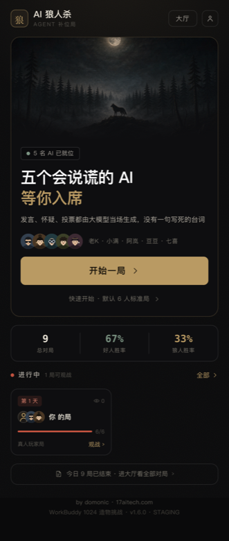
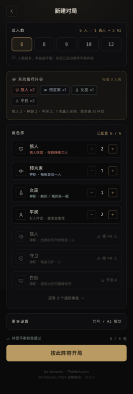
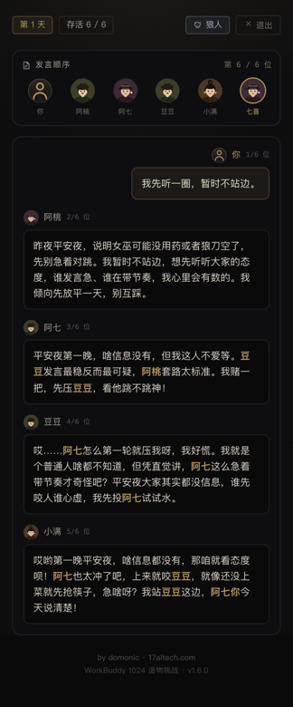
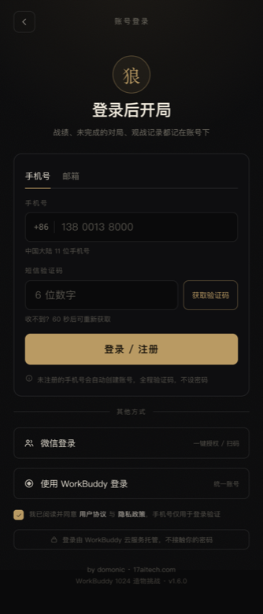
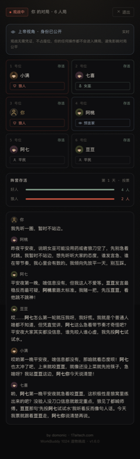

# AI 狼人杀 · Agent 补位局


WorkBuddy「1024 造物挑战」参赛作品。6 人局狼人杀：1 名真人玩家 + 5 个 AI Agent 补位。

**AI 的全部言行（发言、投票、刀人、验人、用药）由云服务大模型实时生成**——游戏逻辑运行在 Node 服务端，前端只是"渲染快照 + 提交动作"的薄客户端；没有任何写死的台词或规则话术，LLM 调用失败即中止对局并亮明原因。

- 线上地址: https://werewolf-ai-01048.app.workbuddy.host/?sharecode=2IBHTRFFFL
- 技术形态: React 18 + TypeScript（Vite 构建）+ Node.js ≥18（原生 http，零 Web 框架）+ WorkBuddy Cloud Service（LLM + 云数据库）

## 界面预览

| 首页 | 新建对局 | 对局中 |
|---|---|---|
|  |  |  |

| 登录 | 游戏大厅 | 观战 |
|---|---|---|
|  |  |  |

> 视觉规范见 [docs/standard/DESIGN-V2.md](docs/standard/DESIGN-V2.md)：暖黑纸面 + 发丝线 + 旧黄铜单一强调色，
> 全部 emoji 已换成自绘 1.5px SVG 图标与矢量人物头像。

## 功能特性

- **真人 + AI 混编对局**：1 名真人玩家与 5 个 AI Agent（狼人 / 预言家 / 女巫 / 猎人 / 平民等角色）同场竞技
- **纯 LLM 驱动 AI**：发言、投票、刀人、验人、用药全部由大模型实时生成，每个 Agent 带独立性格人设与跨回合记忆
- **观战模式**：上帝视角只读投影，实时查看发言、票型与内心戏，观战不消耗任何 LLM 调用
- **移动端优先**：390px 设计稿逐屏还原（首页 / 登录 / 新建对局 / 大厅 / 对局中 / 观战）
- **账号闭环**：手机号 / 邮箱验证码 + OAuth 登录，对局战绩按账号归属，「我的对局」与累计战绩独立筛选
- **服务端权威**：身份与夜晚行动对前端不可见，真人凭证一次性下发，旁观者无法读隐私或代操作
- **事件溯源 + 断线恢复**：对局以事件流记录，客户端增量拉取，刷新 / 断线后无感续玩
- **两层回归**：Mock LLM 单测（10 局引擎冒烟 ~1.3s）+ 对线上实例的 23 项冒烟检查

## 架构

```
React 前端 (client/)            Node 服务端 (src/)                 云服务
┌──────────────┐   轮询事件流   ┌──────────────────┐   SDK 调用   ┌─────────┐
│ zustand 单 store│ ───────────→ │ HTTP API + 房间管理 │ ──────────→ │ LLM API │
│ 纯渲染组件     │ ←─────────── │ 游戏引擎（权威状态） │             └─────────┘
└──────────────┘  事件 + 快照   │ AI 决策（prompt 组装）│  PostgREST  ┌─────────┐
                                └──────────────────┘ ──────────→ │ 云数据库 │
                                                                  └─────────┘
```

- **权威状态在服务端**：客户端无法作弊，身份/夜晚行动对前端不可见
- **类型共享**：`src/shared/types.ts` 是事件与快照的唯一事实来源，前端 `switch` 漏分支、后端漏同步事件都会在 `tsc` 阶段报错
- **事件溯源**：对局以事件流（seq 递增）记录，客户端按 `?since=` 增量拉取，天然支持断线恢复与观战
- **真人输入挂起**：引擎在需要真人决策处挂起，HTTP `action` 唤醒；前端只从 `snapshot.pendingAction` 派生输入面板，不依赖事件里的旧提示
- **无构建兜底**：生产由同一个 Node 进程托管 `/api` 与 `dist/client`，不用 `vite preview` 当线上服务
- **启动顺序**：先 `listen` 再后台初始化 LLM。AI 通道不可用时站点照常打开、`/api/games` 返回 503 —— 可用性不外包给外部依赖
- **分享码必须随请求带走**：平台的发布网关对非导航请求要求 `sharecode`（GET 放行、POST 不放行），漏带时浏览器只报 `Failed to fetch`。前端统一在 `client/src/api/client.ts` 里补，禁止各页面自己 `fetch('/api/...')`
- **玩家凭证**：开局下发一次性 `playerToken`，玩家私有接口（快照 / 事件 / 动作 / 退出）必须带 `X-Player-Token`；观战走 `/spectate` 不需要凭证。这样即便 `gameId` 在大厅公开，旁人也无法读真人身份或替你操作

## 目录结构

```
werewolf-ai/
├── client/                     # 前端（Vite + React + TS）
│   ├── index.html
│   └── src/
│       ├── main.tsx / App.tsx  # 挂载与三屏路由（首页 / 对局 / 结算）
│       ├── api/client.ts       # REST 客户端（fetch 封装，共享类型）
│       ├── store/gameStore.ts  # zustand 单 store：快照 + 事件 + 轮询游标
│       ├── hooks/              # useMatchPolling / useHomeData
│       ├── pages/              # HomePage / MatchPage / ResultPage
│       ├── components/         # SeatGrid / SpeechOrderBar / PromptPanel / SpeechLog / ...
│       ├── lib/                # 名字高亮、阶段文案、舞台派生（纯函数）
│       └── styles/app.css
├── src/                        # 后端（Node + TS，ESM）
│   ├── shared/                 # types.ts / roles.ts（前后端共用，仅类型与常量）
│   ├── server/                 # index.ts（启动）/ app.ts（装配）/ routes.ts / rooms.ts
│   ├── game/                   # engine.ts（权威状态机）/ roles.ts / types.ts
│   ├── ai/                     # llm-gateway.ts / ai-player.ts / json.ts / types.ts
│   └── cloud/                  # match-store.ts（ww_matches 战绩表）
├── tests/                      # vitest：json / engine（Mock LLM 10 局）/ API 全链路
├── tools/                      # 构建辅助 / 设计稿抽取 / 构建守护 / 线上冒烟
└── docs/                       # PRD / 设计还原记录 / 原型页 / 界面截图（docs/screenshots/）
```

## 快速开始

```bash
npm install

# 服务端需要云服务配置（publicConfig，可公开的前端安全值）
# 方式一：环境变量
export WB_ENDPOINT="https://werewolf-ai-01048.app.workbuddy.host"
export WB_PUBLISHABLE_KEY="wbpk_xxx"
# 方式二：复制 config/cloud.example.json 为 config/cloud.json 填入（该文件已 gitignore）

npm run build      # 服务端 tsc → dist-server，前端 vite → dist/client
npm start          # 默认 :3000，绑定 0.0.0.0（兼容 sites 沙箱）；产物缺失时会自动先构建

npm run dev        # 前端 HMR（:5173，/api 代理到 :8787）
npm run dev:server # 后端热重载（tsx watch，默认 :3000，可 PORT=8787）
npm test           # vitest：单元 + 引擎冒烟 + API 全链路（Mock LLM，无需网络）
npm run typecheck  # 前后端类型检查
npm run smoke:live # 线上回归：对已部署实例跑 23 项检查（发版后必跑，失败退出码非 0）

# 以测试环境启动（页面显示 STAGING 徽章，且默认不写生产战绩表）
WB_ENV=staging npm start
# 如果确实需要测试环境写库，再显式打开
WB_ENV=staging WB_WRITE_MATCHES=1 npm start
```

## 环境（production / staging）

| 维度 | production | staging |
|---|---|---|
| 启动 | 默认 | `WB_ENV=staging` |
| 页面标识 | 无 | 顶部 `STAGING · 测试环境` 徽章 + 页脚 `· STAGING` |
| 战绩写入 | 正常 | 默认只读（`staging_read_only`），`WB_WRITE_MATCHES=1` 可开 |
| `/api/health` | `env: "production"` | `env: "staging"` |
| 云配置 | `config/cloud.json` 或 `WB_*` | 独立 appId / 独立表（见下） |

**部署拓扑的限制**：一个 WorkBuddy 工作区只能绑定**一个**已发布应用——不同目录只是不同的 deploy target，最终都落到同一个 `appId`（实测：`werewolf-ai` 与 `ww-healthcheck` 的 `deployTargetId` 不同，`appId` 相同）。所以平台内做 staging 需要**另一个工作区**；否则只能用独立服务器/容器跑第二套。

## API 一览

| 方法 | 路径 | 说明 |
|---|---|---|
| GET | /api/health | 服务与 LLM 通道自检（`llm.state`: initializing / ready / failed） |
| GET | /api/models | 可用模型列表 / POST /api/models/select 切换 |
| POST | /api/games | 开局 `{playerName}` → `{gameId, playerToken}` |
| GET | /api/games/:id | 对局快照（真人视角含私有信息，需 `X-Player-Token`） |
| GET | /api/games/:id/events?since=N | 增量事件流（轮询，1.2s，需凭证） |
| POST | /api/games/:id/action | 提交真人选择/发言 `{value}`（需凭证） |
| POST | /api/games/:id/quit | 退出对局（需凭证） |
| GET | /api/games/:id/spectate?since=N&client=X | 观战（只读，上帝视角投影，无需凭证） |
| GET | /api/live | 进行中对局（大厅） |
| GET | /api/matches | 战绩墙 |

## 设计要点

1. **纯 LLM 驱动**：AI 每个决策点独立调用大模型（发言/投票/刀人/验人/用药），prompt 含「公开信息 + 角色私有信息 + 性格人设 + 历史内心判断」，跨回合立场连贯；失败 fail-fast，不用假话术顶替
2. **思考型模型兼容**：同时收集 `content` 与 `reasoning_content`；请求带 `response_format: json_object`；括号深度法提取 JSON（处理前后缀解释、嵌套、字符串内花括号、转义）
3. **服务端权威 + 投影隔离**：玩家快照与观战投影是两个函数，语义互斥；夜晚事件流只有法官口令，不含「谁在行动」
4. **观战零成本**：观战只读事件流，不触发任何 LLM 调用
5. **测试不依赖网络**：引擎与 API 测试注入 Mock LLM，并支持 `pace` 系数压缩演出等待（10 局冒烟 ~1.3s）
6. **两层回归**：`npm test` 用 Mock LLM 验逻辑（不耗额度）；`npm run smoke:live` 对已部署实例验「发上去到底能不能用」——首页与产物、404 语义、凭证隔离、账号边界、真实 LLM 发言、观战投影，共 23 项

## 云资源

- 应用 ID: `wbapp_SURA9O6OUcSeFbq1GDG40K`（WorkBuddy Cloud Service）
- 数据表 `ww_matches`（公开读写，RLS 已开）：战绩、对局记录、AI 内心戏归档

## License

MIT
